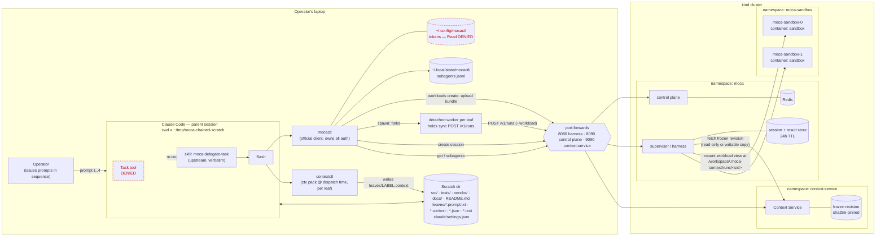
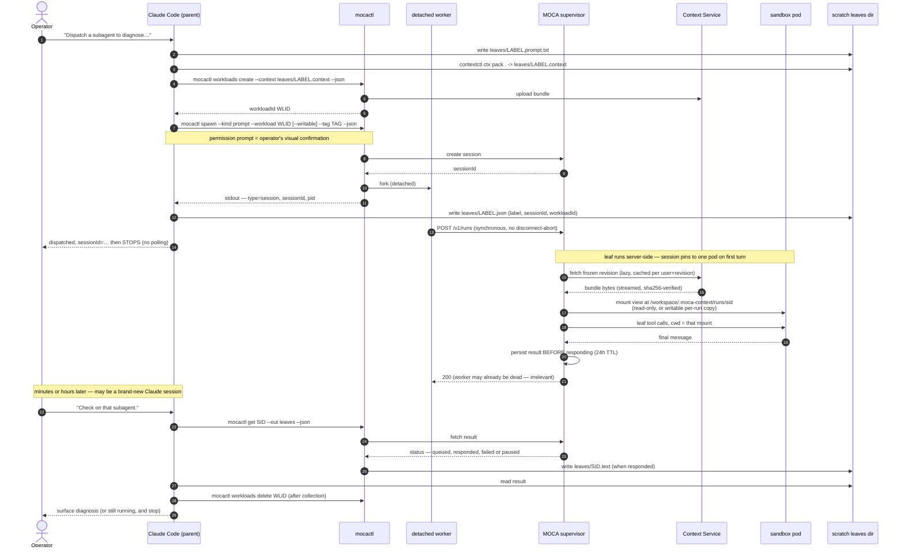

# Architecture

How the pieces of this demo fit together: a local Claude Code session
(the **parent**) dispatches isolated **leaves** to MOCA on a kind
cluster via `mocactl`, against a workload Context Service holds the
files for, and collects their results later.

## Components



Key: dashed red = deliberately blocked by `.claude/settings.json`
(`Task` tool, and reading mocactl's token dir).

## Dispatch / collect sequence (one leaf)



## Chaining: context flows as prompt text only

The parent does the sequencing — MOCA has no "on complete, trigger X"
primitive, and neither leaf knows a chain exists.

```
                leaf 1 "diagnose"                      leaf 2 "fix"
         ┌──────────────────────────┐          ┌──────────────────────────┐
         │ session A                │          │ session B                │
         │ workload WLID_A          │          │ workload WLID_B          │
         │   mounted READ-ONLY      │          │   WRITABLE per-run copy  │
         │ runs tests, reports      │          │ edits src/, runs tests   │
         └────────────┬─────────────┘          └────────────┬─────────────┘
                      │ final message                       │ final message
                      ▼                                     ▼
            leaves/<sidA>.text                     leaves/<sidB>.text
                      │                                     │
                      │  parent inlines VERBATIM             │
                      └────────► leaves/fix.prompt.txt       └──► report to operator

   Each leaf has its own workload, packed and created at dispatch and
   deleted after collection. The writable copy is per-run and discarded
   on completion — nothing persists across runs (that is phase-2
   workloads, https://github.com/rossoctl/moca/issues/476). No file
   paths cross the leaf boundary.
```

Isolation is substrate-enforced at the session level (each session
gets its own view, and each writable run gets its own per-run copy),
so leaves *could* fan out concurrently; this demo deliberately stays
a sequential chain.

## Trust and durability boundaries

| Boundary | What it guarantees | What it does not |
| --- | --- | --- |
| `Task` denied + `moca-delegate-task` skill | Subagent work cannot run in-process on the laptop | — |
| `mocactl` owns auth (`~/.config/mocactl`, Read-denied) | Demo stores no secret; no token plumbing | — |
| Workload mount read-only (diagnose leaf) | The diagnose leaf cannot alter the shared revision | — |
| Writable per-run copy (fix leaf) | Edits are isolated to that run and discarded on completion | **Not durable** — nothing survives to the next run; that is [rossoctl/moca#476](https://github.com/rossoctl/moca/issues/476) |
| Server persists result before responding to `/v1/runs` | Quit Claude, close the laptop, reboot — result survives | Nothing: there is **no cancel** |
| Server-side result store | Collectable for **24h** | Past 24h, or after `teardown.sh`, it's gone |
| Context Service frozen revision | Sha256-pinned, immutable upload; later uploads to the same workload are rejected | — |
| Shared sandbox pool | Workloads and sandbox caches are per user | **Not a security boundary** between users — tasks share the sandbox as the same Linux user. Per-workload sandboxes are [rossoctl/moca#476](https://github.com/rossoctl/moca/issues/476) |
| NetworkPolicy between `moca-sandbox` and everything else | Sandbox network isolation | Requires a NetworkPolicy-enforcing CNI (kind ≥ 0.24.0) |
