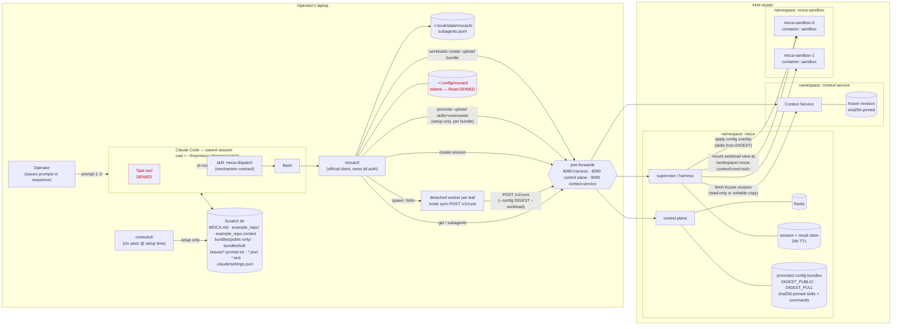

# Architecture

How the pieces of this demo fit together: a local Claude Code session
(the **parent**) dispatches isolated **leaves** to MOCA on a kind
cluster via `mocactl`, against a workload Context Service holds the
files for and promoted config bundles the control plane holds the
skills for, and collects their results later.

## Components



Key: dashed red = deliberately blocked by `.claude/settings.json`
(`Task` tool, and reading mocactl's token dir).

## Dispatch / collect sequence (one leaf)

```mermaid
sequenceDiagram
  autonumber
  actor OP as Operator
  participant CC as Claude Code (parent)
  participant MC as mocactl
  participant W as detached worker
  participant SV as MOCA supervisor
  participant CS as Context Service
  participant SB as sandbox pod
  participant FS as scratch leaves dir

  OP->>CC: "Dispatch a subagent to diagnose…"
  CC->>FS: write leaves/LABEL.prompt.txt
  CC->>MC: mocactl spawn --kind prompt --config DIGEST<br/>--workload WLID [--writable] --tag TAG --json
  Note over CC,MC: permission prompt = operator's visual confirmation<br/>(digest + workload id visible on the command line)
  MC->>SV: create session (configRef=DIGEST, workloadId=WLID)
  SV-->>MC: sessionId
  MC->>W: fork (detached)
  MC-->>CC: stdout — type=session, sessionId, pid
  CC->>FS: write leaves/LABEL.json (label, config, workload, writable)
  W->>SV: POST /v1/runs (synchronous, no disconnect-abort)
  CC-->>OP: dispatched, sessionId=… then STOPS (no polling)

  Note over SV,SB: leaf runs server-side — session pins to one pod on first turn
  SV->>SB: apply config overlay (skills and commands from DIGEST)
  SV->>CS: fetch frozen revision (lazy; cached per user and revision)
  CS-->>SV: bundle bytes (streamed, sha256-verified)
  SV->>SB: mount view at /workspace/.moca-context/runs/sid<br/>(read-only, or writable per-run copy)
  SV->>SB: leaf tool calls, cwd = that mount
  SB-->>SV: final message
  SV->>SV: persist result BEFORE responding (24h TTL)
  SV-->>W: 200 (worker may already be dead — irrelevant)

  Note over OP,CC: minutes or hours later — may be a brand-new Claude session
  OP->>CC: "Check on that subagent."
  CC->>MC: mocactl get SID --out leaves --json
  MC->>SV: fetch result
  SV-->>MC: status — queued, responded, failed or paused
  MC->>FS: write leaves/SID.text (when responded)
  CC->>FS: read result
  CC-->>OP: surface diagnosis (or still running, and stop)
```

## Chaining: context flows as prompt text only

The parent does the sequencing — MOCA has no "on complete, trigger X"
primitive, and neither leaf knows a chain exists.

```
                leaf 1 "diagnose"                      leaf 2 "fix"
         ┌──────────────────────────┐          ┌──────────────────────────┐
         │ session A                │          │ session B                │
         │ config  DIGEST_PUBLIC    │          │ config  DIGEST_FULL      │
         │   (public-posture skill) │          │   (full-access skill)    │
         │ workload WLID            │          │ workload WLID (same)     │
         │   mounted READ-ONLY      │          │   WRITABLE per-run copy  │
         │ runs tests, reports      │          │ edits src/, runs tests   │
         └────────────┬─────────────┘          └────────────┬─────────────┘
                      │ final message                       │ final message
                      ▼                                     ▼
            leaves/<sidA>.text                     leaves/<sidB>.text
                      │                                     │
                      │  parent inlines VERBATIM             │
                      └────────► leaves/fix.prompt.txt       └──► report to operator

   Both leaves share one workload but boot with different config
   bundles — same files, different posture. Each child's identity is
   the triple (config digest, workload revision, sessionId), all
   sha256-pinned and server-held.

   The writable copy is per-run and discarded on completion — nothing
   persists across runs (that is phase-2 workloads,
   https://github.com/rossoctl/moca/issues/476). No file paths cross
   the leaf boundary.
```

Isolation is substrate-enforced at the session level (each session
gets its own view, and each writable run gets its own per-run copy),
so leaves *could* fan out concurrently; this demo deliberately stays
a sequential chain.

## Trust and durability boundaries

| Boundary | What it guarantees | What it does not |
| --- | --- | --- |
| `Task` denied + `moca-dispatch` skill | Subagent work cannot run in-process on the laptop | — |
| `mocactl` owns auth (`~/.config/mocactl`, Read-denied) | Demo stores no secret; no token plumbing | — |
| Promoted config bundle, sha256-pinned | The skills (and commands) a leaf boots with are content-addressed and server-held; two leaves can share one workload but differ in posture | Ships skills + commands only — a `CLAUDE.md` under the promoted dir is NOT included and does not travel to the sandbox |
| Workload mount read-only (diagnose leaf) | The diagnose leaf cannot alter the shared revision | — |
| Writable per-run copy (fix leaf) | Edits are isolated to that run and discarded on completion | **Not durable** — nothing survives to the next run; that is [rossoctl/moca#476](https://github.com/rossoctl/moca/issues/476) |
| Server persists result before responding to `/v1/runs` | Quit Claude, close the laptop, reboot — result survives | Nothing: there is **no cancel** |
| Server-side result store | Collectable for **24h** | Past 24h, or after `teardown.sh`, it's gone |
| Context Service frozen revision | Sha256-pinned, immutable upload; later uploads to the same workload are rejected | — |
| Shared sandbox pool | Workloads and sandbox caches are per user | **Not a security boundary** between users — tasks share the sandbox as the same Linux user. Per-workload sandboxes are [rossoctl/moca#476](https://github.com/rossoctl/moca/issues/476) |
| NetworkPolicy between `moca-sandbox` and everything else | Sandbox network isolation | Requires a NetworkPolicy-enforcing CNI (kind ≥ 0.24.0) |
