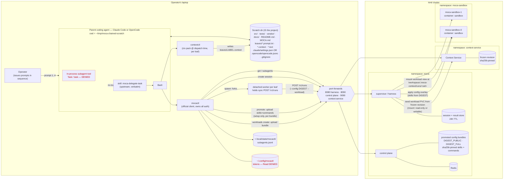
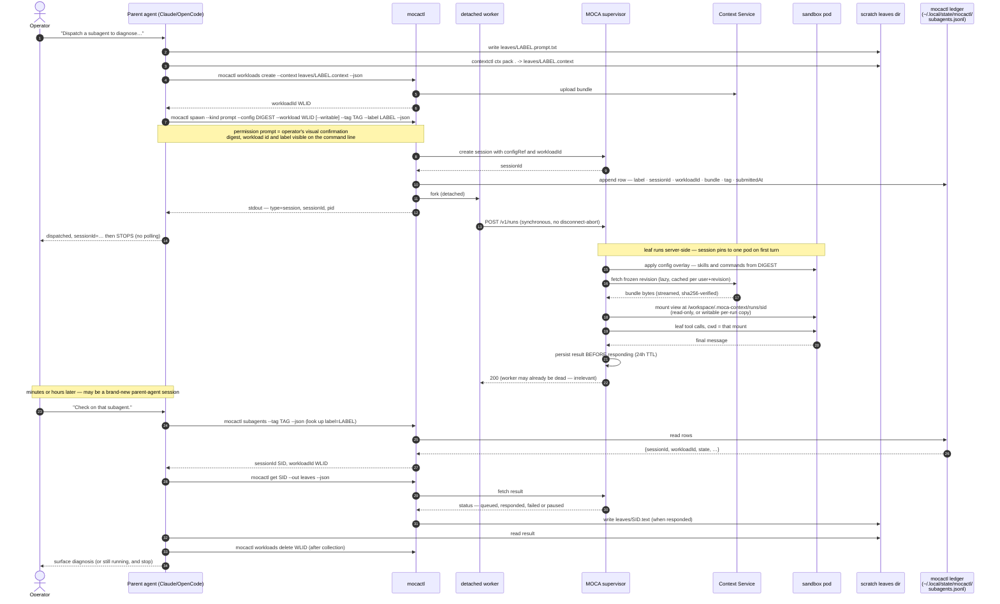

# Architecture

How the pieces of this demo fit together: a local **parent coding
agent** session (Claude Code or OpenCode — picked at setup time with
`PARENT=`) dispatches isolated **leaves** to MOCA on a kind cluster
via `mocactl`, against a workload Context Service holds the files for
and promoted config bundles the control plane holds the skills for,
and collects their results later.

## Components



Key: dashed red = deliberately blocked by the parent agent's config
(`.claude/settings.json` for Claude Code, `.opencode/opencode.jsonc`
for OpenCode) — the in-process subagent tool (`Task` / `task`) and
reading mocactl's token dir.

## Dispatch / collect sequence (one leaf)



## Chaining: context flows as prompt text only

The parent does the sequencing — MOCA has no "on complete, trigger X"
primitive, and neither leaf knows a chain exists.

```
                leaf 1 "diagnose"                      leaf 2 "fix"
         ┌──────────────────────────┐          ┌──────────────────────────┐
         │ session A                │          │ session B                │
         │ config  DIGEST_PUBLIC    │          │ config  DIGEST_FULL      │
         │ workload WLID_A          │          │ workload WLID_B          │
         │   mounted READ-ONLY      │          │   WRITABLE per-run copy  │
         │ runs tests, reports      │          │ edits src/, runs tests   │
         └────────────┬─────────────┘          └────────────┬─────────────┘
                      │ final message                       │ final message
                      ▼                                     ▼
            leaves/<sidA>.text                     leaves/<sidB>.text
                      │                                     │
                      │  parent inlines VERBATIM             │
                      └────────► leaves/fix.prompt.txt       └──► report to operator

   Each leaf has its own workload, packed and created at dispatch and
   deleted after collection, and boots with its own content-addressed
   config bundle — same `mocactl spawn`, different posture. Each
   child's identity is the triple (config digest, workload revision,
   sessionId), all sha256-pinned and server-held. A workload created
   with `--mount writable` keeps edits on its own PVC until the
   workload is deleted, so a follow-up spawn on the same workload sees
   them; a `--mount read-only` workload exposes an immutable view and
   leaves return findings in the final message. No file paths cross
   the leaf boundary.
```

Isolation is substrate-enforced at the workload level (each workload
gets its own StatefulSet and PVC under `moca-sandbox`, provisioned on
activate), so leaves *could* fan out concurrently; this demo
deliberately stays a sequential chain.

## Trust and durability boundaries

| Boundary | What it guarantees | What it does not |
| --- | --- | --- |
| In-process subagent tool (`Task` / `task`) denied + `moca-delegate-task` skill | Subagent work cannot run in-process on the laptop | — |
| `mocactl` owns auth (`~/.config/mocactl`, Read-denied) | Demo stores no secret; no token plumbing | — |
| Promoted config bundle, sha256-pinned | The skills (and commands) a leaf boots with are content-addressed and server-held; two leaves can share one workload but differ in posture | Ships skills + commands only — a `CLAUDE.md` under the promoted dir is NOT included and does not travel to the sandbox |
| Workload mount read-only (diagnose leaf) | The leaf cannot alter the frozen revision | — |
| Workload mount writable (fix leaf) | Each workload gets its own PVC; edits persist across runs on that workload until the workload is deleted | A workload's edits are visible to any spawn on the same workload — a leaf cannot assume the PVC starts at the frozen revision mid-chain |
| Per-workload StatefulSet and PVC under `moca-sandbox` | Two users' workloads do not share a sandbox or disk; `workloads delete` reaps both | — |
| Server persists result before responding to `/v1/runs` | Quit the parent agent, close the laptop, reboot — result survives | Nothing: there is **no cancel** |
| Server-side result store | Collectable for **24h** | Past 24h, or after `teardown.sh`, it's gone |
| Context Service frozen revision | Sha256-pinned, immutable upload; later uploads to the same workload are rejected | — |
| NetworkPolicy between `moca-sandbox` and everything else | Sandbox network isolation | Requires a NetworkPolicy-enforcing CNI (kind ≥ 0.24.0) |
