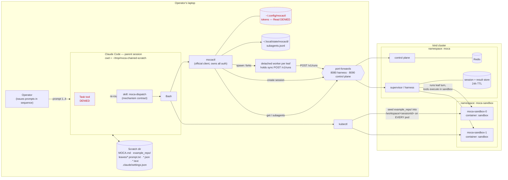

# Architecture

How the pieces of this demo fit together: a local Claude Code session
(the **parent**) dispatches isolated **leaves** to MOCA on a kind
cluster via `mocactl`, and collects their results later.

## Components



Key: dashed red = deliberately blocked by `.claude/settings.json`
(`Task` tool, and reading mocactl's token dir).

## Dispatch / collect sequence (one leaf)

```mermaid
sequenceDiagram
  autonumber
  actor OP as Operator
  participant CC as Claude Code (parent)
  participant MC as mocactl
  participant W as detached worker
  participant SV as MOCA supervisor
  participant SB as sandbox pod
  participant FS as scratch leaves/

  OP->>CC: "Dispatch a subagent to diagnose…"
  CC->>FS: write leaves/<label>.prompt.txt
  CC->>MC: mocactl spawn "$(cat …)" --kind prompt --tag $TAG --json
  Note over CC,MC: permission prompt = operator's visual confirmation
  MC->>SV: create session
  SV-->>MC: sessionId
  MC->>W: fork (detached)
  MC-->>CC: {"type":"session","sessionId":…,"pid":…}
  CC->>FS: write leaves/<label>.json (label→sessionId note)
  W->>SV: POST /v1/runs (synchronous, no disconnect-abort)
  CC->>SB: kubectl cp example_repo/. → /workspace/<sessionId> (every pod)
  CC-->>OP: "dispatched, sessionId=…" then STOPS (no polling)

  Note over SV,SB: leaf runs server-side; session pins to one pod on first turn
  SV->>SB: leaf tool calls, cwd = /workspace/<sessionId>
  Note over SB: leaf waits for package.json if seed hasn't landed
  SB-->>SV: final message
  SV->>SV: persist result BEFORE responding (24h TTL)
  SV-->>W: 200 (worker may already be dead — irrelevant)

  Note over OP,CC: minutes / hours later — may be a brand-new Claude session
  OP->>CC: "Check on that subagent."
  CC->>MC: mocactl get <sessionId> --out leaves --json
  MC->>SV: fetch result
  SV-->>MC: status: queued | responded | failed | paused
  MC->>FS: write leaves/<sessionId>.text (when responded)
  CC->>FS: read result
  CC-->>OP: surface diagnosis (or "still running", and stop)
```

## Chaining: context flows as prompt text only

The parent does the sequencing — MOCA has no "on complete, trigger X"
primitive, and neither leaf knows a chain exists.

```
                leaf 1 "diagnose"                     leaf 2 "fix"
         ┌──────────────────────────┐          ┌──────────────────────────┐
         │ session A                │          │ session B                │
         │ /workspace/<sidA>        │          │ /workspace/<sidB>        │
         │ fresh copy of fixture    │          │ fresh copy of fixture    │
         │ read-only (by prompt)    │          │ edits src/, runs tests   │
         └────────────┬─────────────┘          └────────────┬─────────────┘
                      │ final message                       │ final message
                      ▼                                     ▼
            leaves/<sidA>.text                     leaves/<sidB>.text
                      │                                     │
                      │  parent inlines VERBATIM             │
                      └────────► leaves/fix.prompt.txt       └──► report to operator

   No shared filesystem between leaves. No file paths cross the boundary.
```

Isolation is substrate-enforced at the session level (one session → one
workspace → one fresh fixture), so leaves *could* fan out concurrently;
this demo deliberately stays a sequential chain.

## Trust and durability boundaries

| Boundary | What it guarantees | What it does not |
| --- | --- | --- |
| `Task` denied + `moca-dispatch` skill | Subagent work cannot run in-process on the laptop | — |
| `mocactl` owns auth (`~/.config/mocactl`, Read-denied) | Demo stores no secret; no token plumbing | — |
| One session per leaf → own `/workspace/<sessionId>` | Leaves don't see each other's files by construction | **Not a security boundary** — same user, same container; `cd ..` reaches other sessions |
| Server persists result before responding to `/v1/runs` | Quit Claude, close the laptop, reboot — result survives | Nothing: there is **no cancel** |
| Server-side result store | Collectable for **24h** | Past 24h, or after `teardown.sh`, it's gone |
| Sandbox workspace (container-local, no volume) | Survives until the 30-min idle sweeper or teardown | Pod restart destroys it; files never return to the laptop |
| NetworkPolicy between `moca-sandbox` and everything else | Sandbox network isolation | Requires a NetworkPolicy-enforcing CNI (kind ≥ 0.24.0) |
| Per-leaf tool restrictions | — | None: "read-only" is a prompt, not a capability |

Two local states lie, and `mocactl get` is the tiebreaker:

- `subagents` → `failed: fetch failed` at exactly 5 minutes is the
  worker's own Node HTTP timeout, not the run. The run continues.
- `subagents` → `unknown` means the worker died before the server
  recorded anything. That result never lands; re-dispatch.
